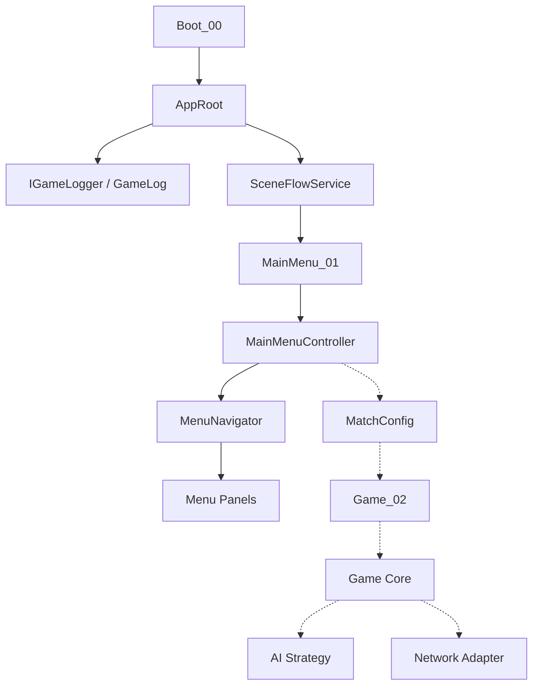
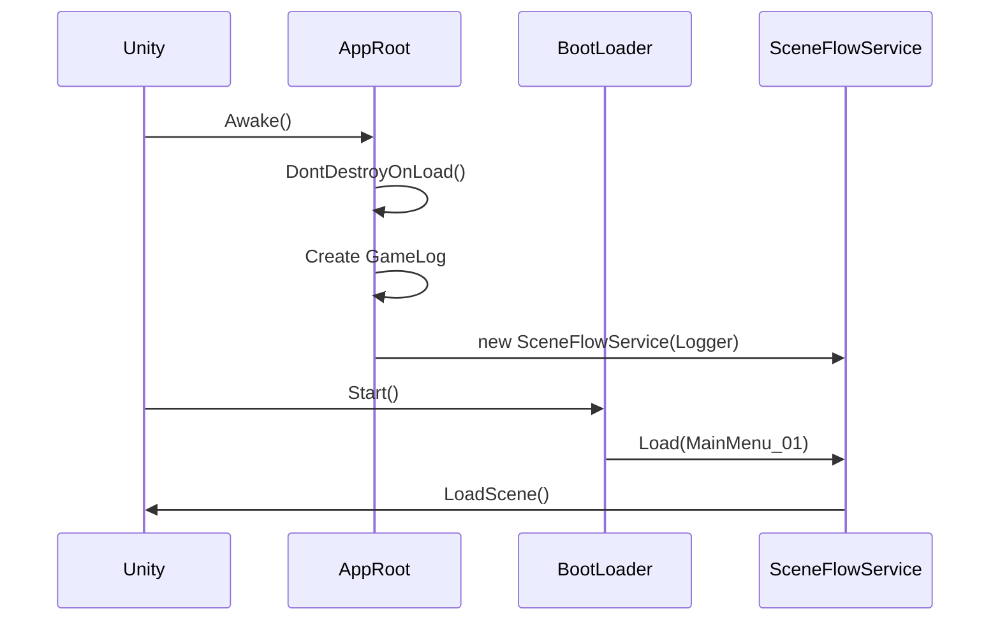
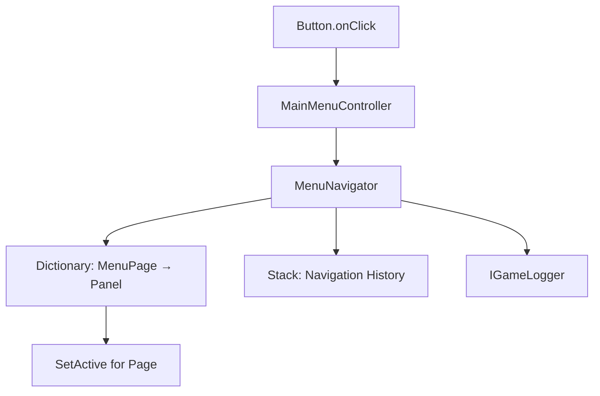
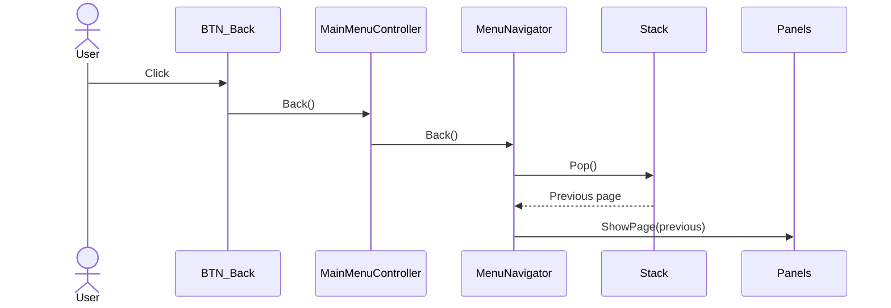
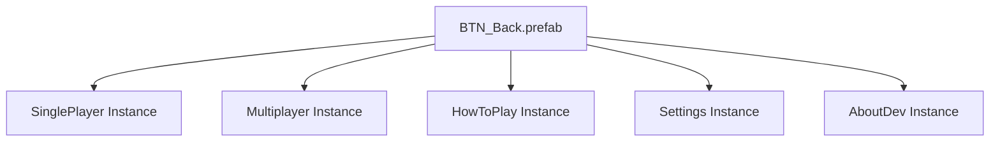
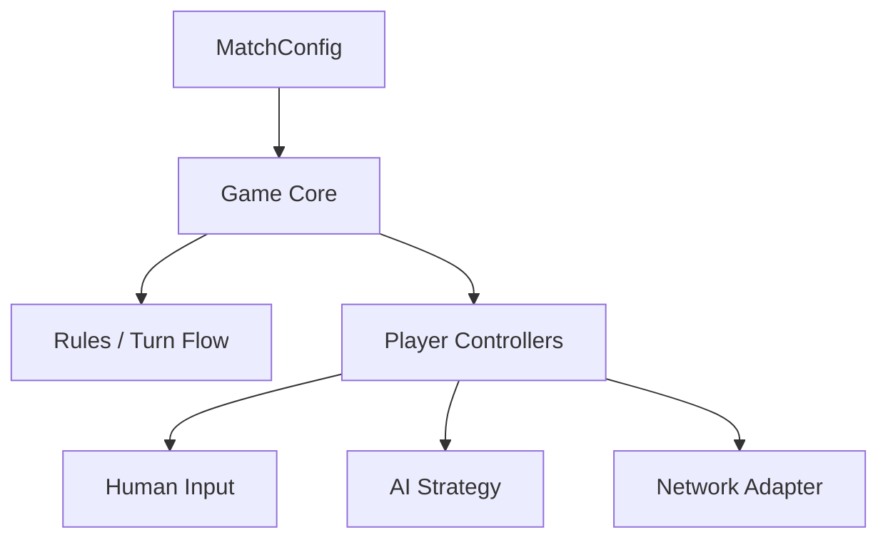

# AgentAvenUnity — Architecture Overview

> Components, dependencies, design patterns, interaction diagrams and architectural decisions.

**Milestone:** M1 — Application Shell & Main Menu  
**Status:** Core initialization verified; button wiring and prefab creation in progress.

## 1. Architecture Principles

- One clear responsibility per component.
- Prefer plain C# services for application logic.
- Use MonoBehaviours when Unity lifecycle or scene integration is needed.
- Prefer explicit dependencies and interfaces.
- Keep gameplay logic independent of menus, graphics and network providers.
- Reuse Prefabs for repeated visual components.
- Implement small working stages and verify them before expanding.

## 2. Application Structure



Solid arrows indicate existing relationships. Dashed arrows indicate future integrations.

## 3. Boot and Application Lifetime

**AppRoot:** Singleton and Composition Root.

**BootLoader:** Starts the initial scene transition.

**SceneFlowService:** Validates and loads scenes.



**Why:** Services have a stable lifetime while scenes are free to load and unload.

## 4. Dependency Injection

### Constructor Injection

AppRoot constructs SceneFlowService with IGameLogger.

```csharp
Logger = new GameLog();
SceneFlow = new SceneFlowService(Logger);
```

SceneFlowService does not construct its logger.

### Method Injection

MainMenuController supplies IGameLogger to the Unity-managed MenuNavigator through Initialize().

```csharp
navigator.Initialize(_logger);
```

Constructor Injection and Method Injection are two ways of supplying dependencies from outside a component.

**Design principles:** Dependency Injection, Dependency Inversion and Separation of Concerns.

## 5. Main Menu Architecture



### Component Responsibilities

| Component | Owns |
|---|---|
| MenuPage | Available menu identifiers |
| MenuPanelEntry | Serialized page-to-panel configuration |
| MenuNavigator | Panel visibility, current page, history |
| MainMenuController | UI commands and scene-level wiring |
| BTN_Back | Reusable visual button |
| OverlayLayer | UI over the current page |

The buttons do not own navigation logic.

## 6. Back Navigation



**Runtime example:**

```text
Current = Main
History = []

Open(SinglePlayer)
Current = SinglePlayer
History = [Main]

Back()
Current = Main
History = []
```

This exact SinglePlayer / Back sequence was verified through Unity logs.

## 7. UI Prefabs and Instances

### Prefab Asset

A reusable Unity asset that stores a GameObject hierarchy and its component configuration.

### Prefab Instance

A GameObject placed into a scene that is linked to a Prefab Asset.

### Instance Override

A setting changed on one instance without necessarily modifying the shared Prefab Asset.

### Back Button Design



The prefab owns appearance and reusable UI components.

Scene instances connect their Button.onClick events to the MainMenuController in their scene.

**Why:** The Prefab Asset should not depend on a scene-owned MainMenuRoot reference.

**Decision:** One Prefab, five Instances, zero additional BackButton scripts.

## 8. Background and Overlay Architecture

```text
MainMenuCanvas
├── Menu_BG_IMG       Shared Background
├── Panel_Main        Navigated Page
├── Panel_SinglePlayer
├── Panel_Multiplayer
├── Panel_HowToPlay
├── Panel_Settings
├── Panel_AboutDev
└── OverlayLayer      Independent Overlays
```

MenuNavigator controls only the registered menu pages.

Menu_BG_IMG remains outside page switching.

OverlayLayer can later host confirmation dialogs, loading screens or compact Quick Settings.

**Important:** Overlays are not automatically pushed onto the MenuNavigator history Stack.

## 9. Design Decision Register

| ID | Decision | Reason |
|---|---|---|
| AD-001 | Persistent AppRoot | Application-wide services survive scene changes |
| AD-002 | Composition Root | Centralize service creation |
| AD-003 | IGameLogger | Replaceable and testable diagnostics |
| AD-004 | MenuPage enum | Type-safe navigation |
| AD-005 | Inspector List + runtime Dictionary | Easy configuration and lookup |
| AD-006 | Stack for Back | LIFO navigation history |
| AD-007 | MainMenuController | Separate input events from state |
| AD-008 | Shared Game_02 | Same core rules for single/multiplayer |
| AD-009 | DevMode-controlled logs | Useful development traces |
| AD-010 | One BTN_Back prefab | Reusable UI and centralized visual style |
| AD-011 | Scene-bound OnClick | Avoid invalid prefab-to-scene references |
| AD-012 | Global menu background | Independent of page visibility |
| AD-013 | Git feature-branch checkpoints | Protect stable development |

## 10. Planned Services and Gameplay

### Application Services

- SettingsService and PlayerPrefs repository
- AudioService / AudioMixer for Music, SFX and Mute
- LocalizationService for English and Hebrew
- Scene transitions and loading overlay

### Game Architecture



These systems are planned, not implemented.

Single Player and Multiplayer will share Game_02.

## 11. Development and Verification

**Verified:** AppRoot, SceneFlow, Logger integration, six-page initialization, SinglePlayer Open and Back.

**In progress:** Back prefab, shared background, remaining button wiring.

**Pending:** Settings, Audio, Localization, MatchConfig, gameplay, networking.

**Workflow:** Plan → Implement → Explain → Test → Document → Checkpoint.

---

[Project Atlas](../PROJECT_ATLAS.md) · [Unity Reference](UNITY_UI_REFERENCE.md)